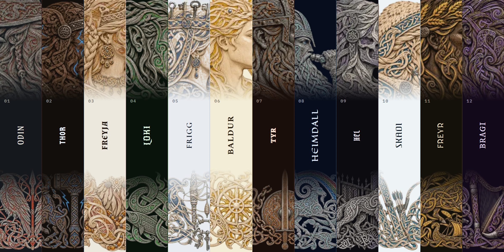

<div align="center">

  <a href="https://github.com/NousResearch/hermes-agent">
    
  </a>

  # Asgard

  **Twelve Norse gods for your Hermes desktop.**

  Twelve themes for Hermes Desktop, carved in runestone and wood. Each god fills the carving with their own colour,
  brings their own lettering, and sets the HERMES AGENT name on a runic band:
  Odin's red runes, Thor's lightning, Loki's green fire, Heimdall's rainbow.

  <sub>FOR <a href="https://github.com/NousResearch/hermes-agent">HERMES DESKTOP</a> &nbsp;·&nbsp; COMMUNITY THEMES &nbsp;·&nbsp; VERSION 0.2.2</sub>

  <br /><br />

  [See all twelve live](https://adolanium.github.io/hermes-asgard/) &nbsp;·&nbsp; [Try it in a minute](#try-it-in-a-minute) &nbsp;·&nbsp; [Meet the twelve](#meet-the-twelve) &nbsp;·&nbsp; [Switch any time](#switch-any-time)

</div>



## Try it in a minute

You need Hermes Desktop 0.22.2 or later. You don't need a terminal.

**1. Install.** In Hermes Desktop, open **Capabilities → Plugins** and click **Install from Git**. Paste this address, click **Review repository**, then install:

```text
https://github.com/Adolanium/hermes-asgard
```

<details>
<summary>Prefer the terminal?</summary>

<br />

```sh
hermes plugins install Adolanium/hermes-asgard
```

If it asks whether to enable the plugin, either answer works. That switch is for the agent side, and Asgard has nothing there.

</details>

**2. Turn it on.** **Asgard** now appears in **Capabilities → Plugins**. Flip its **Desktop** switch on. Desktop plugins installed from a package start turned off, and this is the step people miss.

**3. Pick a god.** Type this in the message box and press Enter:

```text
/skin odin
```

The whole app changes on the spot, with no restart. Try `/skin loki` next, or plain `/skin` to step through every theme you have.

## Meet the twelve

Click a card to see the full window.

| [](media/shots/odin.png?v=0.1.0) | [](media/shots/thor.png?v=0.1.0) |
|:---:|:---:|
| [](media/shots/freyja.png?v=0.1.0) | [](media/shots/loki.png?v=0.1.0) |
| [](media/shots/frigg.png?v=0.1.0) | [](media/shots/baldur.png?v=0.1.0) |
| [](media/shots/tyr.png?v=0.1.0) | [](media/shots/heimdall.png?v=0.1.0) |
| [](media/shots/hel.png?v=0.1.0) | [](media/shots/skadi.png?v=0.1.0) |
| [](media/shots/freyr.png?v=0.1.0) | [](media/shots/bragi.png?v=0.1.0) |

## Switch any time

Every Asgard theme is a normal Hermes theme, so all the usual ways to switch work:

| Where | What to do |
| --- | --- |
| **Message box** | `/skin <name>`, for example `/skin freyja`. `/skin list` shows every theme; `/skin` alone moves to the next one. |
| **Command palette** | Press <kbd>Ctrl</kbd> <kbd>K</kbd> (<kbd>⌘</kbd> <kbd>K</kbd> on macOS), choose **Change theme**, and pick one. |
| **Settings** | **Settings → Appearance → Theme**. |

The names are `odin`, `thor`, `freyja`, `loki`, `frigg`, `baldur`, `tyr`, `heimdall`, `hel`, `skadi`, `freyr` and `bragi`. To go back to the stock look, type `/skin nous`.

Hermes remembers your choice for each profile, so a work profile can keep Odin while a personal one keeps Loki.

## In the terminal too

The twelve gods also come as skins for `hermes` in the terminal, both the classic interface and `hermes --tui`. Each skin draws the god's bust from the Desktop sidebar as pixel art beside the start panel, letters HERMES AGENT in the god's colours, and repaints the prompt, status bar and menus in the god's palette.

Terminal skins are files, not part of the plugin switch, so copy them once after installing, and again after a plugin update:

```sh
mkdir -p ~/.hermes/skins
cp ~/.hermes/plugins/hermes-asgard/cli/skins/*.yaml ~/.hermes/skins/
hermes skin use asgard-odin
```

On Windows, Hermes keeps its home in `%LOCALAPPDATA%\hermes` instead of `~/.hermes`, so in PowerShell:

```powershell
New-Item -ItemType Directory -Force "$env:LOCALAPPDATA\hermes\skins" | Out-Null
Copy-Item "$env:LOCALAPPDATA\hermes\plugins\hermes-asgard\cli\skins\*.yaml" "$env:LOCALAPPDATA\hermes\skins\"
hermes skin use asgard-odin
```

Each skin is the god's name with `asgard-` in front, so a skin never shadows the plugin theme of the same name and Desktop keeps the themes with their art. Inside a session, `/skin asgard-loki` switches too: the prompt, status bar and menus change right away, and the art shows on the next start (`hermes --tui` redraws it at once). Each profile keeps its own skins, so for a profile copy them into `~/.hermes/profiles/<name>/skins/` (on Windows, `%LOCALAPPDATA%\hermes\profiles\<name>\skins\`) as well. `hermes skin use default` goes back to the stock look.

- Each skin also carries `banner_art`, the whole bust image 80 columns wide (30 to 40 rows) dithered in three tones of the Desktop inks, like the Desktop art. The TUI paints one colour per line, so Hermes uses `banner_hero`, the 60-column one-colour version, wherever `banner_art` is not supported or does not fit.
- While you browse skins with `/skin ` and the arrow keys, the classic interface previews each one live: its colours, and a small version of its bust above the menu (`banner_thumb`, shown only by a Hermes that supports it, like `banner_art`). Enter keeps it.
- The art is tuned for dark terminals; on a light terminal the palette switches to its light variant, but the bust stays light.
- The bust is 60 columns wide and sits in the panel's left column. In the TUI that column takes up to 40% of the width, so the bust stays whole from about 160 columns; narrower, its right side is cut.
- Hermes shares the active skin between surfaces, so switching skin in the terminal also switches Desktop. With the plugin on, Desktop follows to the god's full theme, art included: `asgard-loki` in the terminal gives Loki in Desktop. Desktop also lists the terminal skins as themes; picking one there does the same.

The skins are generated from the same art as the Desktop themes: `python3 cli/build_skins.py` (needs Pillow) rewrites `cli/skins/`.

## Small decisions, already made

- **One install, twelve themes.** All twelve ship in a single plugin. There's nothing to choose at install time and nothing extra to download later.
- **Carved, then coloured.** The art is incised runestone, oak and birch in the Viking styles, with the grooves filled in each god's colour: red runes for Odin, lightning for Thor, green fire for Loki, a rainbow for Heimdall.
- **A frame of its own.** The HERMES AGENT wordmark sits on a runic band with notched knotwork edges, the active tab becomes a small shield, and the dividers are double cut lines.
- **Your light or dark setting can't break the art.** Each theme keeps its own palette in both modes. Four are light (Freyja, Frigg, Baldur and Skadi); the other eight are dark.
- **Nothing leaves your machine.** The art and the fonts are packed into `plugin.js`, so themes switch instantly and work fully offline.
- **The chat stays readable.** The art lives in the sidebar and the empty new-session screen. Once a conversation starts, it's text on a calm ground.

## Update or remove

```sh
hermes plugins update hermes-asgard
hermes plugins remove hermes-asgard
```

Or use **Capabilities → Plugins**: switch **Asgard** off to hide the themes, or remove it from there. If an Asgard theme was active, Hermes goes back to its default theme.

## What it touches

- **Theme registration** through the Desktop plugin SDK, the same way any theme plugin adds itself to the picker.
- **Style rules** that apply only while an Asgard theme is active, and disappear when you switch away.
- **Fonts**, bundled inside the plugin under the [SIL Open Font License](LICENSES): IBM Plex Sans and IBM Plex Mono for the interface, and one wordmark face per god: Amarante (Odin), Germania One (Thor), Almendra (Freyja), New Rocker (Loki), Cormorant Unicase (Frigg), Spectral SC (Baldur), Grenze (Tyr), Eagle Lake (Heimdall), Pirata One (Hel), Federant (Skadi), MedievalSharp (Freyr), IM Fell DW Pica SC (Bragi).

It makes no network requests, adds no agent tools, hooks, background processes or settings, and reads none of your data.

The runic band, shield tabs and placement of the art style Hermes Desktop's own markup, because the plugin SDK has no slots for decoration yet. If a Desktop update renames that markup, those touches fall back to the plain palette. Nothing else breaks.

## Compatibility

| Hermes Desktop | Platform | Status |
| --- | --- | --- |
| 0.22.2 | Windows 11 | Tested |
| 0.22.2 | macOS, Linux | Expected to work; not yet tested |

## More gods

Asgard is one of three packs. They install side by side, and none of their theme names overlap, so every god shows up in the same picker.

- **[Pantheon](https://github.com/Adolanium/hermes-pantheon)**: 18 Greek gods in dithered marble, all twelve Olympians and more. [See them live](https://adolanium.github.io/hermes-pantheon/).
- **[Kemet](https://github.com/Adolanium/hermes-kemet)**: 12 Egyptian gods in painted relief and gold leaf. [See them live](https://adolanium.github.io/hermes-kemet/).

<br />

<div align="center">
  <strong>Asgard</strong><br />
  <sub>Twelve gods, cut in stone.</sub>
</div>

<br />

## License

[MIT](LICENSE). The bundled fonts are under the SIL Open Font License; see [LICENSES](LICENSES).

> **Community project**
>
> Asgard is an independent community theme pack. It is not affiliated with, endorsed by, sponsored by, or officially associated with [Nous Research](https://github.com/NousResearch) or the [Hermes Agent project](https://github.com/NousResearch/hermes-agent). Hermes, Hermes Agent, and Nous Research are names and marks belonging to their respective owners.
